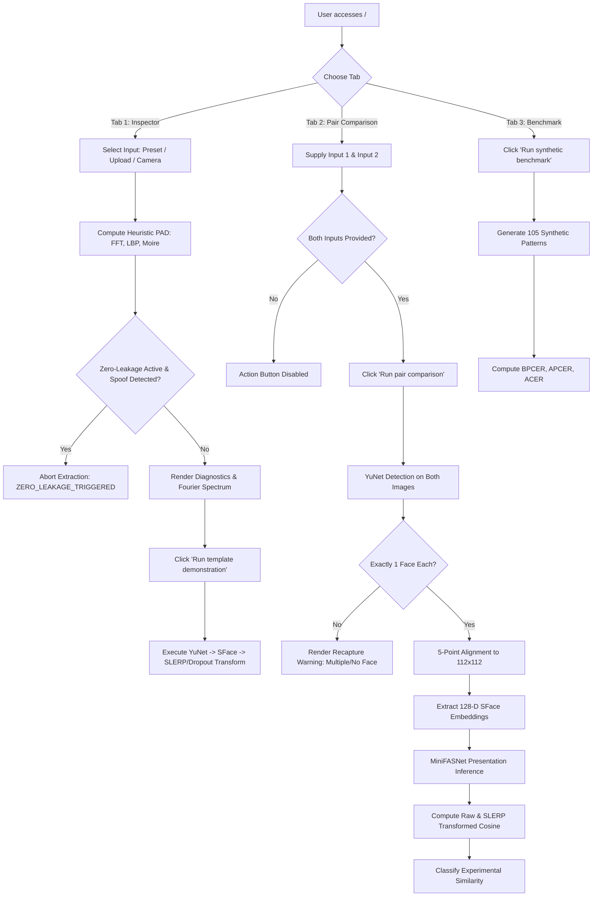

# GuardFace Architecture & Full-Stack System Analysis

**Document Version:** 1.0.0  
**Audit Target:** GuardFace Face Comparison & Presentation Attack Detection Prototype  
**Auditor:** Senior QA Engineer & Full-Stack Security/Performance Auditor  
**Date:** November 1, 2026  
**Environment:** Windows 10/11 x64, Python 3.11.16, Streamlit 1.66.1, OpenCV 4.12.0.88, PyTorch 2.13.0+cpu  
**Application Target URL:** `http://127.0.0.1:8501`

---

## 1. System Identity, Purpose, and Target Audience

### 1.1 Product Identity
GuardFace is an experimental, offline biometrics research platform and interactive web dashboard. It integrates facial detection, five-landmark geometric alignment, deep face feature embeddings, multi-tier Presentation Attack Detection (PAD), and mathematical template protection mechanisms (Spherical Linear Interpolation / SLERP rotation and randomized dimensionality dropout).

### 1.2 Target Audience
- **Biometric & Security Researchers:** Evaluating facial recognition robustness, template invertibility, and cancelable biometric algorithms.
- **Machine Learning Engineers & Computer Vision Practitioners:** Prototyping multi-modal face anti-spoofing pipelines combining spatial heuristics, frequency-domain analysis, and lightweight deep neural networks.
- **Security & Privacy Auditors:** Assessing privacy-preserving feature transformations, threat-model boundaries, and cryptographic key derivations.

### 1.3 Core Operating Boundaries & Disclaimers
- **Strictly Advisory & Research-Only:** The application explicitly disables authentication decisions in all execution modes.
- **No Liveness Proof:** Neither heuristic texture metrics nor deep learning presentation estimates establish certified physical presence or liveness (ISO/IEC 30107-3 compliance is neither claimed nor achieved).
- **No Access Control:** Match classifications (`similar`, `different`, `uncertain`) are uncalibrated diagnostic measurements based on an OpenCV SFace reference threshold (0.363 ± 0.030 band) and must not be used as an authorization gate.

---

## 2. Technology Stack, Architecture & Dependencies

### 2.1 Frontend & User Interface
- **Framework:** Streamlit 1.66.1 (Python reactive web framework).
- **Communication Protocol:** Bidirectional WebSockets (`/_stcore/stream`) accompanied by REST/HTTP management endpoints for health checks, file uploads, and static asset delivery.
- **Client Runtime:** Modern web browsers (Chromium, Firefox, WebKit) rendering React-based Streamlit UI components, CSS grid/flex layouts, HTML5 Canvas, and WebRTC media streams (`st.camera_input`).

### 2.2 Backend & Numerical Engine
- **Interpreter:** CPython 3.11.16 (64-bit Windows).
- **Image Processing & Computer Vision:**
  - `opencv-python` (4.12.0.88): Runs YuNet ONNX face detection (`face_detection_yunet_2023mar.onnx`) and SFace ONNX feature recognition (`face_recognition_sface_2021dec.onnx`), 5-point affine transformation matrix warping (`cv2.estimateAffinePartial2D` / `cv2.warpAffine`), and Haar Cascade legacy detection.
  - `Pillow` (13.0.0): Image loading, sanitization, EXIF transposition, size bounding, and format verification.
- **Deep Learning / Neural Networks:**
  - `torch` (2.13.0+cpu) & `torchvision` (0.22.0+cpu): Powers learned MiniVision MiniFASNet models (`2.7_80x80_MiniFASNetV2.pth` and `4_0_0_80x80_MiniFASNetV1SE.pth`) for Tier-2 presentation attack estimation.
  - Pinned `third_party/tface` (Tencent TFace backbone subset): Architecture definitions for optional research backbones (IR-50, Modified ResNet).
- **Scientific Computing & Signal Analysis:**
  - `numpy` (2.2.6): Vector manipulation, normalized cosine computations, and spherical transformations.
  - `scipy` (1.17.1): 2D Fast Fourier Transform (`scipy.fft.fft2`), radial frequency integration, and Local Binary Pattern (LBP) entropy calculations.
  - `matplotlib` (3.11.1): Offline diagnostic visualization rendering.

### 2.3 Storage & Security Mechanisms
- **Local Research Store (`modules/template_store.py`):** SQLite database (`templates.db`) using atomic transaction management, write-ahead logging (WAL), and Windows Data Protection API (DPAPI via `CryptProtectData` and `CryptUnprotectData` in `crypt32.dll`) for user-scope payload encryption.
- **Keyless Key Derivation (`modules/keyless_pin.py`):** PBKDF2 HMAC-SHA256 (100,000 iterations) with salt and pepper derivation for ephemeral SLERP rotation keys.
- **Zero-Disk In-Memory Processing:** Uploaded images and video frames are decoded in memory (`io.BytesIO`) as volatile NumPy arrays; no raw unencrypted photos are persisted to disk during UI interactions.

---

## 3. Pages, Routes, and Navigation Architecture

Streamlit functions as a single-page reactive application (SPA) where navigation is state-driven via tabs and sidebar controls.

### 3.1 Web Routes & Endpoints
| Route | Method | Purpose / Behavior | Auth / Permissions |
|---|---|---|---|
| `/` | `GET` | Serves main HTML, loads CSS/JS bundles, initializes session | Anonymous / Public |
| `/_stcore/health` | `GET` | Application health check; returns `ok` with HTTP 200 | Public / No Auth |
| `/_stcore/allowed-message-origins` | `GET` | Returns JSON array of allowed origins for cross-window messages | Public |
| `/_stcore/stream` | `WebSocket` | Primary state synchronization, widget events, and DOM tree diffs | Public / Session ID |
| `/_stcore/upload_file/{session_id}/{file_id}` | `POST` | Multipart upload handler for `st.file_uploader` | Session-scoped |
| `/_stcore/upload_file/{session_id}/{file_id}` | `DELETE` | Deletes uploaded file buffer from session | Session-scoped |
| `/_stcore/static/*` | `GET` | Static asset serving (fonts, icons, vendor scripts) | Public |
| `/*` (unmapped) | `GET` | Streamlit 404 handler (`404: Not Found`) | Public |

### 3.2 Application Views (Tabs & Layouts)
1. **Sidebar Navigation & Controls:**
   - Heuristic PAD threshold slider (`0.40` – `0.80`)
   - SLERP rotation parameter $\alpha$ slider (`0.00` – `0.95`)
   - Feature dropout rate slider (`0.00` – `0.90`)
   - Cosine similarity threshold slider (`-1.000` – `1.000`)
   - Checkbox: "Use synthetic feature demo"
   - Checkbox: "Enforce Zero-Leakage Protocol"
   - Password Input: "Keyless PIN (optional)"
   - Text Input: "Trained checkpoint path (optional)"
   - Model status indicator and system operational notices
2. **Tab 1: "🔍 PAD & Template Inspector":**
   - Single-image input via Preset (Skin / Print / Screen patterns), File Upload, or WebRTC Camera.
   - Real-time heuristic diagnostics (Liveness score, attack badge, Tier-2 status, Moiré score, High-frequency decay ratio, LBP entropy, Chrominance diversity, and 2D Fourier power spectrum).
   - Single-image template transformation action: "Run template demonstration".
3. **Tab 2: "🤝 Pair Comparison":**
   - Dual-image inputs (Reference Input vs Comparison Input).
   - Independent selection of Preset, File Upload, or Camera for each input.
   - Primary action: "Run pair comparison".
   - Comparison dashboard: Raw descriptor cosine, transformed descriptor cosine, experimental decision badge (`similar`, `different`, or `uncertain`), bounding box dimensions, face detection confidence, head pose estimation (yaw, pitch, roll), and MiniFASNet bona fide scores.
4. **Tab 3: "📊 Synthetic Benchmark":**
   - Automated evaluation harness executing 105 synthetic test patterns across 3 attack/bona-fide classes.
   - Real-time computation of BPCER, APCER, and ACER.

### 3.3 Command-Line & Headless Entry Points
- `verify_with_antispoof.py`: Standalone CLI comparison tool emitting structured JSON reports.
- `manage_templates.py`: CLI for DPAPI SQLite template store management.
- `evaluate_dataset.py`: Batch evaluation of paired verification datasets.
- `evaluate_antispoof.py`: Quantitative heuristic PAD benchmarking.
- `generate_report_images.py`: Generation of research figures and diagnostic plots.
- `run_guardface.ps1`: Unified PowerShell dispatch script (`demo`, `cli`, `eval`, `test`).

---

## 4. Feature Set & User Flows

### 4.1 Detailed Flow Specifications
1. **Image Ingestion & Validation Flow:**
   - Raw bytes intercepted from file uploader, base64 WebRTC camera, or synthetic generator.
   - Enforces 20 MB size ceiling.
   - Verifies valid JPEG/PNG headers, 3 color channels, finite 8-bit integers, non-zero width/height.
   - Strips EXIF metadata and normalizes orientation.
2. **Facial Alignment & Embedding Pipeline:**
   - YuNet locates bounding box and 5 facial landmarks (left eye, right eye, nose tip, left mouth corner, right mouth corner).
   - Validates face presence: exactly 1 face permitted. Zero or >1 faces reject processing.
   - Affine transformation aligns eye coordinates horizontally and rescales to standard $112 \times 112$ RGB crop.
   - SFace ONNX engine extracts normalized 128-dimensional embedding vector.
3. **Presentation Attack Detection (Dual-Tier):**
   - **Tier-1 (Spatial & Frequency Heuristics):** Analyzes high-frequency FFT energy roll-off, peak-to-sidelobe ratio (Moiré interference), LBP micro-texture entropy, and YCrCb chrominance variance. Produces heuristic PAD score $[0, 1]$.
   - **Tier-2 (Learned MiniFASNet Models):** Deep neural networks evaluate $80 \times 80$ patches across 2 model variants, outputting bona fide softmax probability.
   - **Zero-Leakage Enforcement:** If active, Tier-1 detection of spoof intercepts and terminates feature extraction immediately to prevent biometric template compromise.
4. **SLERP & Dropout Feature Transformation:**
   - SFace 128-D vector partitioned into 8 groups of 16 dimensions.
   - Key generation: Either generated ephemerally via CSPRNG (`secrets.randbits(256)`) or derived from user PIN via PBKDF2 HMAC-SHA256.
   - Spherical Linear Interpolation rotates feature vector toward key vector by angle $\alpha \times \theta$.
   - Feature dropout zeros out `drop_rate` percentage of dimensions per group.

---

## 5. Security & Risk Analysis

### 5.1 Critical Risks & Weak Spots Identified
1. **Unrestricted Checkpoint Path Input (`Arbitrary Code Execution Risk`):**
   - The sidebar exposes `st.text_input("Trained checkpoint path (optional)")`.
   - In PyTorch, loading arbitrary `.pth` checkpoints via standard `torch.load()` can deserialize arbitrary Python objects (`pickle`), allowing Remote Code Execution (RCE) if an untrusted user supplies a malicious file path or uploaded model.
2. **Missing Form Container for Password Field (DOM / Accessibility Warning):**
   - Streamlit renders `user_pin = st.text_input("Keyless PIN (optional)", type="password")` outside an HTML `<form>` element.
   - Browsers log security/accessibility warnings and password autofill / credential management behavior may be compromised.
3. **Absence of Authentication / Authorization (Local Trust Model):**
   - The application binds to `127.0.0.1:8501` without an authentication layer, CSRF tokens on internal APIs, or session access controls.
   - Any process or local browser tab running on the host has full administrative control over inference, configurations, and benchmarking.
4. **WebSocket & DoS via Heavy Computation:**
   - Streamlit reruns Python execution on every widget interaction. Rapid slider adjustments or repeated benchmark triggers spawn heavy CPU computations (FFT, deep neural network forward passes) which can exhaust CPU resources and cause connection lag.
5. **Memory Consumption on Large Uploads:**
   - Although a 20 MB file size limit is implemented, multiple concurrent sessions uploading uncompressed bitmap payloads could stress memory allocations on restricted nodes.
6. **Biometric Failure Modes:**
   - The system strictly expects exactly 1 face. False rejections occur on extreme yaw/pitch angles, heavy occlusions (masks/glasses), or low lighting.
   - Synthetic threshold (0.363 ± 0.030) is an empirical LFW baseline, not calibrated across diverse demographics or sensor optical transfer functions.

---

## 6. Test Plan

The comprehensive audit will execute tests across 12 distinct categories:

### Category 1: Functional Testing
- **1.1:** Tab navigation and switching (Inspector, Pair Comparison, Benchmark).
- **1.2:** Sidebar configuration controls (sliders, checkboxes, inputs).
- **1.3:** Preset selection and rendering across all 3 synthetic patterns.
- **1.4:** File upload functionality with valid PNG and JPEG face images.
- **1.5:** Camera input capture integration.
- **1.6:** Template demonstration execution in Tab 1.
- **1.7:** Pair comparison execution in Tab 2 with matching, non-matching, and identical face pairs.
- **1.8:** Zero-Leakage Protocol enforcement (feature abort vs advisory continuation).
- **1.9:** Keyless PIN derivation and transform key persistence across session state.
- **1.10:** Synthetic benchmark automated execution in Tab 3.

### Category 2: Input Validation
- **2.1:** Uploading empty / 0-byte image files.
- **2.2:** Uploading corrupted / truncated image files (`corrupt.png`).
- **2.3:** Uploading non-image file types (`.txt`, `.pdf`, `.exe`, `.py`).
- **2.4:** Uploading oversized image files (> 20 MB).
- **2.5:** Extreme slider boundary values (alpha = 0.00, alpha = 0.95, dropout = 0.00, dropout = 0.90, threshold = -1.000, threshold = 1.000).
- **2.6:** Malformed checkpoint path strings (non-existent paths, traversal sequences `../../`, special characters).
- **2.7:** Malformed PIN strings (SQL injection `' OR '1'='1`, XSS ``, Unicode emojis, very long 10,000-char strings).

### Category 3: UI / UX Assessment
- **3.1:** Typography, layout alignment, visual hierarchy, and element spacing.
- **3.2:** Loading indicators, progress bars, and spinner responsiveness during model inference.
- **3.3:** Clear presentation of advisory disclaimers and experimental badges.
- **3.4:** Empty states and button disabled states when required inputs are absent.
- **3.5:** Contrast ratios of diagnostic text, metrics, and badges against both light and dark backgrounds.

### Category 4: Responsive Design
- **4.1:** Mobile Viewport (375 × 667 px / iPhone SE / 390 × 844 px).
- **4.2:** Tablet Viewport (768 × 1024 px / iPad).
- **4.3:** Laptop Viewport (1366 × 768 px).
- **4.4:** Desktop High-Resolution Viewport (1920 × 1080 px).
- **4.5:** Horizontal overflow, text clipping, and sidebar collapse behavior across all breakpoints.

### Category 5: Cross-Browser & Multi-Context Behavior
- **5.1:** Headless Chromium rendering and feature compatibility.
- **5.2:** Multi-session isolation: independent browser tabs executing distinct operations without cross-talk or state contamination.
- **5.3:** Session state persistence across browser refresh (F5).

### Category 6: Performance & Resource Utilization
- **6.1:** Initial page load time and time to interactive (TTI).
- **6.2:** Latency of YuNet face detection and SFace extraction.
- **6.3:** Latency of MiniFASNet dual-model inference.
- **6.4:** Benchmark throughput (105 synthetic evaluations execution duration).
- **6.5:** Memory stability during repeated runs and file uploads.

### Category 7: Accessibility (A11y)
- **7.1:** Keyboard navigation (Tab order, arrow key slider adjustments, Enter/Space button activations).
- **7.2:** ARIA roles, states, and properties on interactive controls (`role="tab"`, `role="slider"`, `role="button"`).
- **7.3:** Accessible names and labels for form inputs, sliders, and file uploaders.
- **7.4:** Color contrast compliance (WCAG 2.1 AA 4.5:1 standard).
- **7.5:** DOM heading structure (`<h1>` to `<h3>`) consistency.

### Category 8: Security & Privacy
- **8.1:** Validation of in-memory image handling (confirming no raw images written to temporary filesystem).
- **8.2:** Inspection of client-side payloads for leakage of raw embedding vectors, secret transform keys, or encryption masks.
- **8.3:** Localhost binding security and exposure check.
- **8.4:** Analysis of `torch.load` security posture regarding custom checkpoint inputs.
- **8.5:** Examination of HTTP response headers (`X-Frame-Options`, `Content-Security-Policy`, CORS).

### Category 9: API & Endpoint Verification
- **9.1:** Health endpoint status (`/_stcore/health` returns HTTP 200).
- **9.2:** Origin validation (`/_stcore/allowed-message-origins`).
- **9.3:** 404 behavior on non-existent endpoints.
- **9.4:** Programmatic Python API stability (`verify_with_antispoof.run_pipeline`).

### Category 10: Console & Network Logs
- **10.1:** Capture of browser JavaScript console errors, warnings, and unhandled promise rejections.
- **10.2:** Inspection of network requests for failed calls, 4xx/5xx responses, or slow assets.

### Category 11: SEO & Metadata
- **11.1:** Document title, favicon, and meta tags.
- **11.2:** Single-page app metadata relevance for internal research tools.

### Category 12: Edge Cases & Error Recovery
- **12.1:** Rapid double-clicking on inference buttons.
- **12.2:** Switching tabs mid-inference.
- **12.3:** Providing images with 0 faces (e.g. blank background).
- **12.4:** Providing images with multiple faces (> 1 face).
- **12.5:** Rapid slider oscillation triggering multiple concurrent WebSocket reruns.

